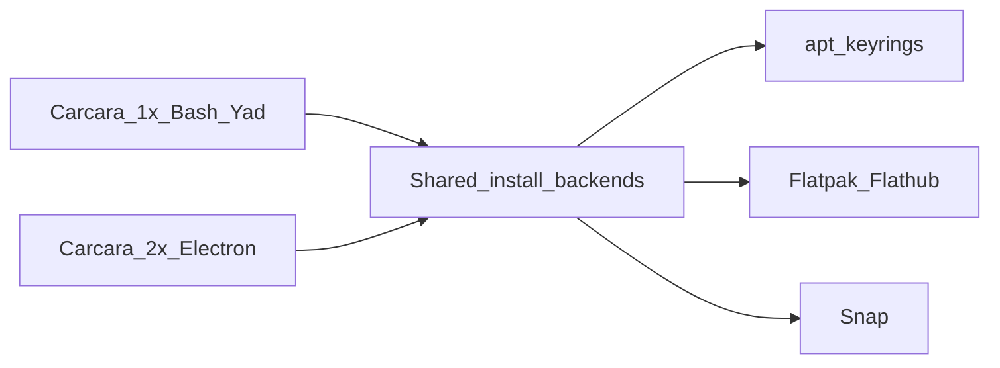

# Idea — Carcará 2.0 (Electron)

Status: **vision / not started**  
Saved: 16 de Novembro de 2026  
Related: [mylinux.md](mylinux.md) · [carcara-modern-install.md](carcara-modern-install.md) (1.x Bash line)

## Intent

Ship a **Carcará 2.0** desktop app with a modern UI using **Electron**, while **Carcará 1.x** (Bash + Zenity/Yad under `carcara/`) remains the active modernization track until 2.0 is ready.

1.x keeps working on headless-ish / scriptable installs; 2.0 is the polished workstation control panel.

## Why Electron

- Familiar web UI (HTML/CSS/JS or a small React/Vue layer) without inventing a new desktop toolkit.
- Better layout, theming, accessibility, and progress UX than Yad dialogs.
- Can still call the same install backends (apt keyrings, Flatpak, Snap) via a privileged helper or `pkexec`/`sudo` bridge — UI must never be the source of truth for package safety.

## Product sketch (2.0)

| Area | 2.0 behavior |
|------|----------------|
| Shell | Electron main + renderer; no Yad/Zenity required for primary UX |
| Actions | Update / repair / clean / install curated apps (same categories as today) |
| Install engine | Reuse policies from 1.x `install_backends` (apt → Flatpak → Snap) — preferably as shared scripts or a small Node/Go helper invoked by Electron |
| Privilege | Explicit elevation per dangerous action; clear logs in the UI |
| Dotfiles | Optional later tab: apply/backup from `dotfiles/` with confirmation |
| WSL | Detect WSLg; degrade gracefully with copy-paste CLI fallback if no display |

## Suggested stack (when planning starts)

- Electron (current LTS) + TypeScript
- UI: lightweight (e.g. plain CSS or a minimal component set) — brand later; avoid dragging unrelated design systems
- Packaging: `.deb` and/or AppImage for Debian/Ubuntu family
- Keep **npm** if Node tooling is used (repo convention)

Exact framework choice (React vs vanilla) is deferred until a dedicated 2.0 plan wave.

## Relationship to 1.x

- Finish / stabilize 1.x waves in [carcara-modern-install.md](carcara-modern-install.md) so backends exist.
- 2.0 consumes those backends; do not fork install logic into the renderer.
- Do not delete 1.x when 2.0 ships — keep as CLI/fallback entry (`startApp.sh`).

## Non-goals (2.0 vision)

- Not a cloud SaaS, not multi-tenant.
- Not a full distro installer / ISO builder.
- Not silent remote `curl | bash` as the default install path for the app itself.
- Not replacing `dotfiles/` with a cloud sync product in v2.0.0.

## Open questions (resolve before coding 2.0)

1. Privilege model: `pkexec` helper vs “run whole app as root” (prefer helper).
2. First UI kit: vanilla vs React.
3. Package artifact: `.deb` only vs AppImage + deb.
4. Repo layout: `carcara-electron/` sibling vs monorepo app under `carcara/v2/`.

## Checklist (do not start until explicitly requested)

- [ ] Write detailed 2.0 plan (stack, folder layout, privilege helper)
- [ ] Spike: Electron window + one apt dry-run via helper
- [ ] Port menus (system + software categories) to 2.0 UI
- [ ] Package `.deb` / AppImage
- [ ] Document dual entry: 1.x script vs 2.0 app in root README
