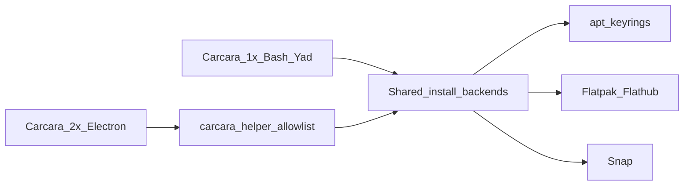

# Idea — Carcará 2.0 (Electron)

Status: **in progress** (plan locked + spike started)  
Saved: 16 de Novembro de 2026  
Updated: 17 de Novembro de 2026 (env/Zod, Dotfiles rail, license gate, carcara_confirm → playbook + memory-bank)  
Related: [mylinux.md](mylinux.md) · [carcara-modern-install.md](carcara-modern-install.md) (1.x engine — complete)

## Intent

Ship **Carcará 2.0** as a desktop app with a modern UI using **Electron**.  
**Carcará 1.x** (`carcara/` Bash + Zenity/Yad) stays as CLI/fallback and owns the install engine (`install_backends.sh` + thin installers).

## Locked decisions (17 de Novembro de 2026)

| Question | Decision |
|----------|----------|
| Repo layout | Sibling app: **`carcara-electron/`** (do not nest under Bash `carcara/`) |
| Toolchain | **[Bun](https://bun.sh/docs)** — install, scripts, and Shell (`$`) bridge ([runtime/shell](https://bun.sh/docs/runtime/shell)) |
| UI kit | **Vanilla** HTML/CSS + TypeScript renderer (no React for first ship) |
| UI/UX | Skill **`ui-ux-pro-max`** → `design-system/carcara-2-0/` (Flat Design, dark utility) |
| Privilege | App runs as **root** (like 1.x `isRoot`); helper allowlist via Bun bridge (pkexec only if somehow non-root) |
| Packaging | Later: `.deb` first; AppImage optional — not part of the spike |
| Engine | **Reuse** `carcara/app/config/install_backends.sh` and existing system/app scripts — never reimplement apt/flatpak/snap in the renderer |

## Why Electron + Bun

- Web UI without inventing a new desktop toolkit.
- Better layout, theming, accessibility, and progress UX than Yad.
- Same install backends via privileged helper; UI is never the source of truth for package safety.
- Bun owns package install + build scripts + safe shell orchestration (`import { $ } from "bun"`). Electron main still uses Chromium’s Node and **spawns** `bun scripts/run-helper.ts` so Shell APIs stay on the Bun runtime.

## Product sketch

| Area | 2.0 behavior |
|------|----------------|
| Shell | Electron main + preload + renderer; Yad/Zenity not required for primary UX |
| Actions | Update / repair / clean / install curated apps (same categories as 1.x) |
| Install engine | Invoke 1.x scripts/backends through `helper/carcara-helper.sh` |
| Privilege | Explicit elevation per dangerous action; stream logs into the UI |
| Dotfiles | Rail view → helper `dotfiles-*` → `dotfiles/apply.sh` as `$SUDO_USER` |
| WSL | Detect limited GUI/polkit; show CLI fallback hints |

## Stack

- **Bun** ≥ 1.1 (package manager + script runner + Shell)
- Electron (current stable) + TypeScript (main/preload compiled with `tsc` for Electron’s Node)
- Vanilla renderer (PT labels, same verbs as 1.x)
- Scripts: `bun run dev` / `build` / `start` / `helper`
- Helper: Bash allowlist under `carcara-electron/helper/` + Bun bridge `scripts/run-helper.ts`

## Repo layout

```
assets/img/                   # logo.png (1.x docs + 2.0 UI)
carcara-electron/
  package.json                # packageManager: bun
  bun.lock
  tsconfig.json
  helper/carcara-helper.sh    # pkexec-facing allowlist
  scripts/
    build.ts                  # Bun.$ → tsc + copy static + assets/img/logo.png
    run-helper.ts             # Bun.$ → pkexec|helper
  src/
    main.ts                   # BrowserWindow + IPC → spawn bun bridge
    preload.ts
    renderer/
      index.html              # #app mount + CSP
      styles.css
      main.ts                 # entry → Bun bundle → dist/renderer/renderer.js
      app.ts                  # shell + routing
      views/                  # one file per menu
        sistema.ts
        software.ts
        sobre.ts
        index.ts
      components/             # reusable UI factories
        tile.ts / tile-grid.ts / group.ts / rail.ts / …
      lib/                    # types + helper API
  README.md
design-system/carcara-2-0/    # ui-ux-pro-max MASTER + page overrides
  MASTER.md
  pages/app-shell.md
```

## App UI layout (`ui-ux-pro-max`)

Canonical tokens and rules: [`design-system/carcara-2-0/MASTER.md`](../../design-system/carcara-2-0/MASTER.md).  
Shell overrides: [`design-system/carcara-2-0/pages/app-shell.md`](../../design-system/carcara-2-0/pages/app-shell.md).

| Decision | Choice |
|----------|--------|
| Skill | `.agents/skills/ui-ux-pro-max` (search + `--design-system --persist`) |
| Style | **Flat Design** — dark utility, teal primary `#0D9488`, accent CTA `#EA580C` |
| Structure | Sidebar nav + primary pane + activity log (desktop tool, not landing “Product Demo”) |
| Type | Inter / system-ui (no remote font CDN under Electron CSP) |
| A11y | Focus rings, keyboard nav, reduced-motion, no emoji-as-icons |

Any new 2.0 screen: read page override under `pages/` first, else MASTER. Re-run the skill search when changing visual direction — do not invent a parallel palette.

## Privilege helper contract

- Renderer → preload IPC → Electron main → `bun scripts/run-helper.ts <action>` → Bun `$` → `pkexec` (or direct) `helper/carcara-helper.sh`.
- Helper allowlist: system (`ping`, `apt-dry-run`, `update-distro`, `fix-system`, `clean-distro`) + installs (`install-vlc|discord|spotify|telegram|git|vscode|insomnia|firacode|dropbox`).
- System/install actions run 1.x scripts under `CARCARA_NONINTERACTIVE=1` (no Yad; `carcara_confirm` auto-yes when root/NI).
- UI confirms before mutating actions; streams helper stdout/stderr into Atividade.
- Unknown actions → exit 2. No arbitrary shell from the UI.

## Relationship to 1.x



- Do not delete 1.x when 2.0 ships — keep `cd carcara && sudo bash startApp.sh`.
- Dual entry: repo-root **`./start.sh`** (interactive or `--electron` / `--terminal`).

## Non-goals

- Not a cloud SaaS / multi-tenant product.
- Not a full distro installer / ISO builder.
- Not silent remote `curl | bash` as the default install path for the app itself.
- Not replacing `dotfiles/` with cloud sync in v2.0.0.
- Not porting Yad polish or a third Bash “polish wave”.

## Implementation checklist

- [x] Write detailed 2.0 plan (stack, folder layout, privilege helper)
- [x] Spike scaffold: `carcara-electron/` + Bun bridge (`bun run build` / `bun scripts/run-helper.ts ping` OK; GUI/`pkexec` validation pending)
- [x] UI direction via `ui-ux-pro-max` → `design-system/carcara-2-0/` + app-shell renderer
- [x] Full UI rebuild from scratch (Flat tokens, rail + tiles + dialog confirm, brand `logo_moderno_final`) — 17 de Novembro de 2026
- [x] Renderer modular: `views/{sistema,software,sobre}.ts` + reusable `components/` (Bun IIFE bundle) — 17 de Novembro de 2026
- [x] Port system actions (update / fix / clean) through helper → 1.x scripts (17 de Novembro de 2026)
- [x] Port software categories / installers through helper (17 de Novembro de 2026)
- [x] Terminal theme (Dracula + JetBrains Mono + line highlight); brand rail polish; Software category rail (17 de Novembro de 2026)
- [x] Sobre from README + WSL-safe `openExternal`; `ping` unprivileged (no pkexec noise) (17 de Novembro de 2026)
- [x] Session knowledge consolidated in playbook + memory-bank (17 de Novembro de 2026)
- [x] Root gate for 2.0 UI + live Sistema smoke-test (update/fix/clean exit 0) (17 de Novembro de 2026)
- [x] Env: `.env.example` + Zod/`dotenv` (`src/env.ts`) wired to main + helper (17 de Novembro de 2026)
- [x] Dotfiles rail + helper `dotfiles-*` → `apply.sh` as `$SUDO_USER` (17 de Novembro de 2026)
- [x] License gate (1.x parity: checkbox Continuar before shell) (17 de Novembro de 2026)
- [ ] Package `.deb` (AppImage optional)
- [ ] Software installer smoke-test via 2.0 UI
- [x] Document dual entry in root README + `carcara-electron/README.md` (alpha)
