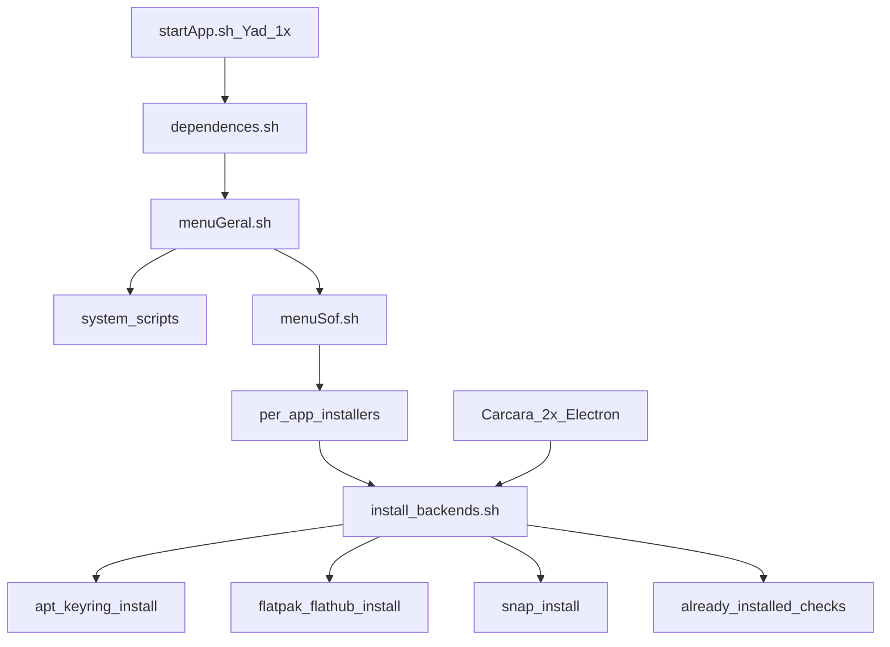

# Idea — Modernize Carcará install stack (Debian/Ubuntu+) — **1.x**

Status: **complete** (Waves 1–2)  
Saved: 16 de Novembro de 2026  
Related: [mylinux.md](mylinux.md) · [carcara-2.0-electron.md](carcara-2.0-electron.md) · playbook [carcara.md](../playbook/references/carcara.md)

## Strategy (given Carcará 2.0 Electron)

Treat **1.x as the install engine + CLI/fallback**, not the final UI product.

| Invest in 1.x | Defer / skip in 1.x |
|---------------|---------------------|
| `install_backends.sh` (apt keyrings, Flatpak, Snap, idempotency, exit codes) | Yad/Zenity polish, animations, “pretty” dialogs |
| System scripts with correct apt behavior | TUI polish (`gum`, fancy dry-run UI) |
| Thin installers that call backends (stable **contract** for Electron) | Rewriting UX twice for Yad then Electron |
| Minimal menu wiring so backends can be tested | Large Yad-only feature work |

**2.0** ([carcara-2.0-electron.md](carcara-2.0-electron.md)) calls the same backends via a privilege helper. Do not fork install logic into the Electron renderer.

## Overview

1.x delivered shared install helpers and thin app installers. Yad/Zenity remain the **temporary** CLI/TUI front-end; product UI moves to Electron 2.0.

## Defaults

- **Backend policy:** (1) official **apt/.deb** with modern keyrings when the vendor ships a signed repo; (2) **Flatpak + Flathub** for most GUI apps; (3) **Snap** only when that is the practical/recommended channel (or classic confinement). Never revive `apt-key` or blind `curl | bash` in new code.
- **Wave 1:** bootstrap + **`install_backends.sh`** + system scripts + menu wiring — **done**.
- **Wave 2:** thin installers onto backends — **done**.
- **WSL:** helpers must detect limited GUI/Snap/Flatpak and warn instead of failing obscurely.
- **Script header:** every Carcará `.sh` file **must** keep the banner below.

### Script header convention (required on all Carcará scripts)

Canonical examples: `carcara/app/scripts/system/cleanDistro.sh`, `carcara/app/scripts/system/updateDistro.sh`.

```bash
#----------------------------------------------------------------------------------------------------#
# Data criação: <original or creation date>
# Última alteração: <DD/MM/AAAA por extenso>   # optional; update when rewriting
# Nome: Gabriel F. Vilar (CoGUMm)
# E-mail: gabriel[at]cogumm[dot]net
# Telegram: http://t.me/CoGUMm
# Script: <scriptName>
# Descrição: <one-line purpose in Portuguese or English>
# Variáveis: $<name> : <what it loads / means>
#----------------------------------------------------------------------------------------------------#
```

Example for `Última alteração` (DD/MM/AAAA por extenso): `16 de Novembro de 2026` (= 16/11/2026).

Rules:

- Place the banner near the top (after shebang / `clear` / config source is OK, matching existing style).
- Keep author identity as above unless the owner changes it.
- List important variables (`$configYad`, `$SUDO_USER`, paths, etc.) in `Variáveis`.
- Use Portuguese long-form dates (not ISO `YYYY-MM-DD`). Months: Janeiro, Fevereiro, Março, Abril, Maio, Junho, Julho, Agosto, Setembro, Outubro, Novembro, Dezembro.
- On modernization edits, set or refresh `Última alteração` when rewriting.
- Applies to: `startApp.sh`, `app/config/*.sh`, `app/scripts/**/*.sh`, and helpers such as `install_backends.sh`.

## Target architecture



Shared library: `carcara/app/config/install_backends.sh` — **main 1.x deliverable for 2.0.**

### Backend helpers (Wave 1 Step 2) — done

| Helper | Behavior |
|--------|----------|
| `pkg_present` | `command -v` / `dpkg -s` / `flatpak info` / `snap list` |
| `ensure_apt_keyring_repo` | Key in `/etc/apt/keyrings/*.gpg`, signed `sources.list.d` entry, `apt-get update` |
| `apt_install` | `DEBIAN_FRONTEND=noninteractive apt-get install -y` + capture status |
| `ensure_flatpak_flathub` | Install flatpak if missing; add Flathub remote |
| `flatpak_install` | `flatpak install -y flathub <app-id>` |
| `snap_install` | `snap install …` (+ `--classic` when needed) |
| `run_with_progress` | Optional Yad pulsate **without** hiding exit codes; always printable logs for Electron |

### Install preference per app class (Wave 2) — done

| Class | Preferred channel | Examples |
|-------|-------------------|----------|
| System / CLI | apt | git, curl, fonts via apt when available |
| GUI (cross-distro) | Flatpak/Flathub | Discord, Spotify, Telegram, VLC, Insomnia |
| Vendor desktop IDE | Official Microsoft apt repo (keyring) or Snap classic | VS Code |
| Productivity | Flatpak / Snap | Dropbox |

## Wave 1 — Foundation — **done**

Steps 1–5 completed (16–17 de Novembro de 2026): bootstrap, `install_backends.sh`, system scripts, menus, ShellCheck.

## Wave 2 — Thin installers — **done**

utilities → social → development → productivity; each installer calls backends with idempotent checks.

## Non-goals (this 1.x Bash plan)

- No Nix/Guix/Home Manager migration.
- No rewriting `old/` in place.
- No Electron UI **here** — see [carcara-2.0-electron.md](carcara-2.0-electron.md).
- No silent `curl | bash` as default UX.
- No investing in Yad as the long-term product UI.
- No further 1.x “polish” wave — product UI is 2.0.

## Implementation checklist

- [x] Wave 1 Step 1 — deps / startApp / config sourcing (16 de Novembro de 2026)
- [x] Wave 1 Step 2 — `install_backends.sh` (17 de Novembro de 2026)
- [x] Wave 1 Step 3 — system scripts (17 de Novembro de 2026)
- [x] Wave 1 Step 4 — minimal menu wiring (17 de Novembro de 2026)
- [x] Wave 1 Step 5 — ShellCheck + docs (17 de Novembro de 2026)
- [x] Wave 2 — thin installers onto backends (17 de Novembro de 2026)

**1.x complete.** Active product UI work: [carcara-2.0-electron.md](carcara-2.0-electron.md).
