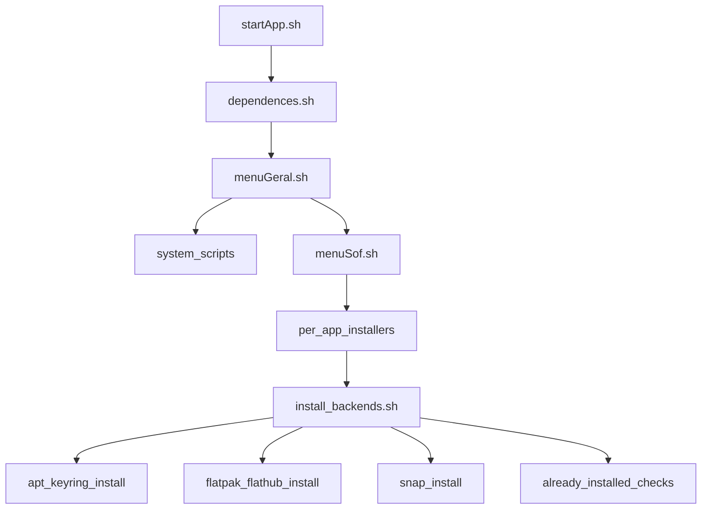

# Idea — Modernize Carcará install stack (Debian/Ubuntu+)

Status: **planned, not implemented**  
Saved: 2026-11-16  
Related: [mylinux.md](mylinux.md) · playbook [carcara.md](../playbook/references/carcara.md)

## Overview

Modernize Carcará in waves: shared install helpers using current Debian/Ubuntu practices (apt + signed keyrings, Flatpak/Flathub, Snap as fallback), then rewrite each app installer on top of that foundation.

## Defaults (gradual modernization)

- **Backend policy:** (1) official **apt/.deb** with modern keyrings when the vendor ships a signed repo; (2) **Flatpak + Flathub** for most GUI apps; (3) **Snap** only when that is the practical/recommended channel (or classic confinement). Never revive `apt-key` or blind `curl | bash` in new code.
- **Wave 1:** foundation + system scripts + menu wiring. App installer rewrites come in Wave 2+ (one category at a time).
- **WSL:** helpers must detect limited GUI/Snap/Flatpak and warn instead of failing obscurely.
- **Script header:** every Carcará `.sh` file **must** keep a banner comment block like `cleanDistro.sh` / `updateDistro.sh` (see below). New and rewritten scripts follow the same shape; when touching a script that lacks it, restore/add the header.

### Script header convention (required on all Carcará scripts)

Canonical examples: `carcara/app/scripts/system/cleanDistro.sh`, `carcara/app/scripts/system/updateDistro.sh`.

```bash
#----------------------------------------------------------------------------------------------------#
# Data criação: <original or creation date>
# Última alteração: <DD/MM/AAAA por extenso>   # optional; update when rewriting
# Nome: Gabriel F. Vilar (CoGUMm)
# E-mail: gabriel[at]cogumm[dot]net
# Telegram: http://t.me/CoGUMm
# Script: <scriptName>
# Descrição: <one-line purpose in Portuguese or English>
# Variáveis: $<name> : <what it loads / means>
#----------------------------------------------------------------------------------------------------#
```

Example for `Última alteração` (DD/MM/AAAA por extenso): `16 de Novembro de 2026` (= 16/11/2026).

Rules:

- Place the banner near the top (after shebang / `clear` / config source is OK, matching existing style).
- Keep author identity as above unless the owner changes it.
- List important variables (`$configYad`, `$SUDO_USER`, paths, etc.) in `Variáveis`.
- Use Portuguese long-form dates (not ISO `YYYY-MM-DD`). Months: Janeiro, Fevereiro, Março, Abril, Maio, Junho, Julho, Agosto, Setembro, Outubro, Novembro, Dezembro.
- On modernization edits, set or refresh `Última alteração` when rewriting.
- Applies to: `startApp.sh`, `app/config/*.sh`, `app/scripts/**/*.sh`, and any new helper such as `install_backends.sh`.

## Why (current gaps)

Carcará is ~2020-era: broken `carcara/app/config/dependences.sh`, wrong includes (`. app/config.sh` vs `. app/config/config.sh`), brittle `which -a`, Snap-only installers, menus stubbed for Development/Productivity, apt piped into Yad without checking exit codes.

## Target architecture



Shared library: one new file `carcara/app/config/install_backends.sh` next to `config.sh`, sourced by installers.

### Backend helpers (Wave 1)

| Helper | Behavior |
|--------|----------|
| `pkg_present` | `command -v` / `dpkg -s` / `flatpak info` / `snap list` |
| `ensure_apt_keyring_repo` | Key in `/etc/apt/keyrings/*.gpg`, signed `sources.list.d` entry, `apt-get update` |
| `apt_install` | `DEBIAN_FRONTEND=noninteractive apt-get install -y` + capture status |
| `ensure_flatpak_flathub` | Install flatpak if missing; add Flathub remote |
| `flatpak_install` | `flatpak install -y flathub <app-id>` |
| `snap_install` | `snap install …` (+ `--classic` when needed) |
| `run_with_progress` | Yad pulsate without hiding `PIPESTATUS` / exit code |

### Install preference per app class (Wave 2+)

| Class | Preferred channel | Examples |
|-------|-------------------|----------|
| System / CLI | apt | git, curl, fonts via apt when available |
| GUI (cross-distro) | Flatpak/Flathub | Discord, Spotify, Telegram, VLC, Insomnia if on Flathub |
| Vendor desktop IDE | Official Microsoft apt repo (keyring) or Snap classic | VS Code |
| Productivity | Official .deb/Flatpak | Dropbox — verify current vendor method |

Confirm Flathub app IDs / apt package names per-app when Wave 2 starts. Do not hardcode obsolete PPAs.

## Wave 1 — Foundation (do first)

### Step 1 — Stabilize bootstrap

- Fix `carcara/app/config/dependences.sh`: detect `yad`, `zenity`, `curl` with `command -v` / `dpkg -s`; install via apt; optionally ensure `flatpak` + `snapd` with clear messages.
- Fix `carcara/startApp.sh` license/`case $?` fall-through (restore Zenity license gate or remove dead `case`).
- Unify sourcing: every script uses `. app/config/config.sh` when cwd is `carcara/`.

### Step 2 — Add shared install library

- New file: `carcara/app/config/install_backends.sh` (shared idempotent install API), **with the required script header banner**.
- Source from `config.sh` or from each installer after `config.sh`.
- Document in `.agents/playbook/references/carcara.md`.
- When rewriting any script in later steps, preserve or add the header (see “Script header convention”).

### Step 3 — Modernize system scripts

- `updateDistro.sh` — `apt-get update` then upgrade/`full-upgrade` with confirms; surface failures.
- `fixSystem.sh` — keep `-f install` / `dpkg --configure -a`; safer lock messaging.
- `cleanDistro.sh` — keep clean/autoclean/autoremove; dpkg-lock deletion only with **explicit confirm**.

### Step 4 — Wire menus that already have scripts

- `menuSof.sh`: Desenvolvimento → existing `development/*.sh`; Produção → `dropbox.sh` (or honest stub removal).
- Add `development/_menu.sh` following `social/_menu.sh` pattern when needed.

### Step 5 — Quality gate

- `bash -n` on touched scripts.
- ShellCheck via `.agents/skills/shellcheck-configuration`.
- Update `docs/carcara.md`, playbook, `memory-bank/TODO.md` / `progress.md`.

**Wave 1 exit criteria:** deps work; menus reach every existing installer; system scripts report apt exit codes; shared backends exist even if app scripts still call Snap temporarily.

## Wave 2 — Rewrite app installers (category by category)

1. **Utilities** — VLC via Flatpak (`org.videolan.VLC`) or apt `vlc`.
2. **Social** — Discord / Spotify / Telegram via Flathub IDs (verify current).
3. **Development** — git/fonts via apt; Insomnia via Flatpak or official channel; VS Code via Microsoft apt keyring or Snap classic (document choice in script header).
4. **Productivity** — Dropbox via current official method (not dead URLs from `old/`).

Thin installer shape:

```bash
. app/config/config.sh
. app/config/install_backends.sh
# greet → idempotent check → preferred backend → Yad success/fail
```

## Wave 3 — Polish (after installers)

- Dry-run / non-root “help only” mode.
- Optional root `init.sh` wrapper → `carcara/startApp.sh`.
- Install backlog skills when useful: `bash-scripting`, then `debian-linux-triage`.
- `nala` only as a later optional nicer apt UI — not required for Wave 1.

## Non-goals

- No Nix/Guix/Home Manager migration.
- No rewriting `old/` in place.
- No Electron/HTML installer UI.
- No silent `curl | bash` as default UX.

## Implementation checklist (when execution is requested)

- [x] Wave 1 Step 1 — deps / startApp / config sourcing (2026-11-16)
- [ ] Wave 1 Step 2 — `install_backends.sh`
- [ ] Wave 1 Step 3 — system scripts
- [ ] Wave 1 Step 4 — menu wiring
- [ ] Wave 1 Step 5 — ShellCheck + docs
- [ ] Wave 2 — utilities → social → development → productivity
- [ ] Wave 3 — polish

First coding session (when approved): **Wave 1 only**.
