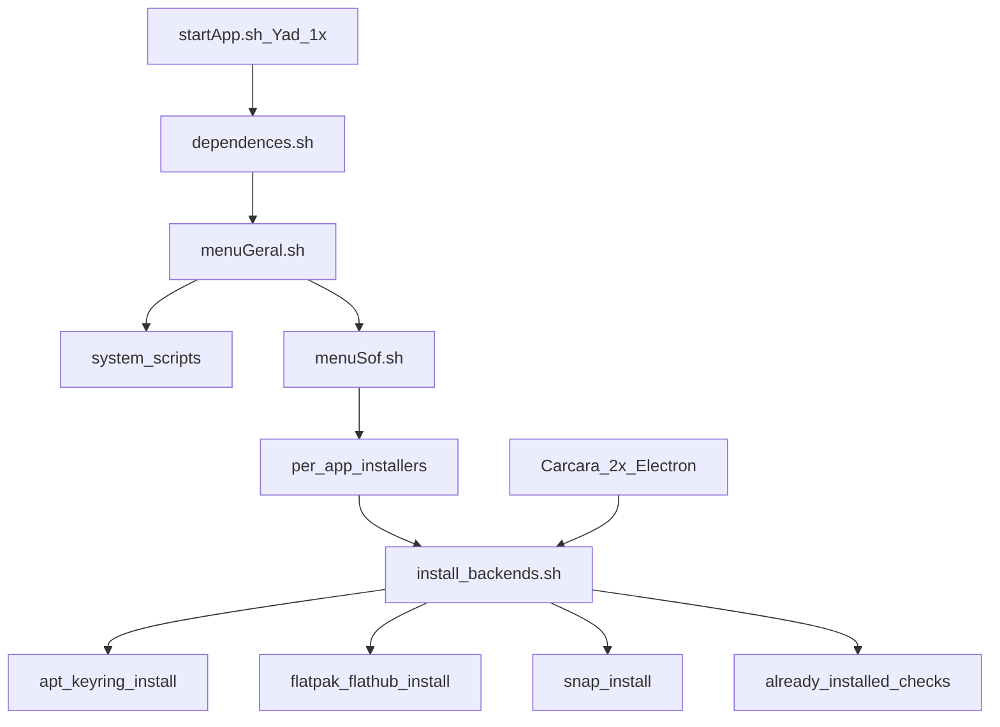

# Idea — Modernize Carcará install stack (Debian/Ubuntu+) — **1.x**

Status: **in progress** (Wave 1 Step 1 done)  
Saved: 16 de Novembro de 2026  
Related: [mylinux.md](mylinux.md) · [carcara-2.0-electron.md](carcara-2.0-electron.md) · playbook [carcara.md](../playbook/references/carcara.md)

## Strategy (given Carcará 2.0 Electron)

Treat **1.x as the install engine + CLI/fallback**, not the final UI product.

| Invest in 1.x | Defer / skip in 1.x |
|---------------|---------------------|
| `install_backends.sh` (apt keyrings, Flatpak, Snap, idempotency, exit codes) | Yad/Zenity polish, animations, “pretty” dialogs |
| System scripts with correct apt behavior | Wave 3 TUI polish (`gum`, fancy dry-run UI) |
| Thin installers that call backends (stable **contract** for Electron) | Rewriting UX twice for Yad then Electron |
| Minimal menu wiring so backends can be tested | Large Yad-only feature work |

**2.0** ([carcara-2.0-electron.md](carcara-2.0-electron.md)) will call the same backends via a privilege helper. Do not fork install logic into the Electron renderer later.

## Overview

Modernize Carcará in lean waves: shared install helpers (current Debian/Ubuntu practices), then thin app installers. Yad/Zenity stay as a **temporary** front-end until Electron 2.0.

## Defaults (gradual modernization)

- **Backend policy:** (1) official **apt/.deb** with modern keyrings when the vendor ships a signed repo; (2) **Flatpak + Flathub** for most GUI apps; (3) **Snap** only when that is the practical/recommended channel (or classic confinement). Never revive `apt-key` or blind `curl | bash` in new code.
- **Wave 1 (priority):** bootstrap + **`install_backends.sh`** + system scripts + enough menu wiring to exercise them.
- **Wave 2 (lean):** rewrite installers onto backends only — success/fail/log matter; Yad toasts are enough.
- **Wave 3:** **low priority / mostly skip** if 2.0 is next — optional CLI helpers only (`init.sh`, dry-run flags), not Yad redesign.
- **WSL:** helpers must detect limited GUI/Snap/Flatpak and warn instead of failing obscurely.
- **Script header:** every Carcará `.sh` file **must** keep the banner below.

### Script header convention (required on all Carcará scripts)

Canonical examples: `carcara/app/scripts/system/cleanDistro.sh`, `carcara/app/scripts/system/updateDistro.sh`.

```bash
#----------------------------------------------------------------------------------------------------#
# Data criação: <original or creation date>
# Última alteração: <DD/MM/AAAA por extenso>   # optional; update when rewriting
# Nome: Gabriel F. Vilar (CoGUMm)
# E-mail: gabriel[at]cogumm[dot]net
# Telegram: http://t.me/CoGUMm
# Script: <scriptName>
# Descrição: <one-line purpose in Portuguese or English>
# Variáveis: $<name> : <what it loads / means>
#----------------------------------------------------------------------------------------------------#
```

Example for `Última alteração` (DD/MM/AAAA por extenso): `16 de Novembro de 2026` (= 16/11/2026).

Rules:

- Place the banner near the top (after shebang / `clear` / config source is OK, matching existing style).
- Keep author identity as above unless the owner changes it.
- List important variables (`$configYad`, `$SUDO_USER`, paths, etc.) in `Variáveis`.
- Use Portuguese long-form dates (not ISO `YYYY-MM-DD`). Months: Janeiro, Fevereiro, Março, Abril, Maio, Junho, Julho, Agosto, Setembro, Outubro, Novembro, Dezembro.
- On modernization edits, set or refresh `Última alteração` when rewriting.
- Applies to: `startApp.sh`, `app/config/*.sh`, `app/scripts/**/*.sh`, and any new helper such as `install_backends.sh`.

## Why (current gaps)

Carcará is ~2020-era: brittle installers, Snap-only paths, menus stubbed for Development/Productivity, apt exit codes hidden by Yad pipes. Bootstrap (deps / license / config sourcing) was fixed in Wave 1 Step 1; backends and system scripts remain.

## Target architecture



Shared library: one new file `carcara/app/config/install_backends.sh` next to `config.sh`. **This file is the main 1.x deliverable for 2.0.**

### Backend helpers (Wave 1 Step 2) — high priority

| Helper | Behavior |
|--------|----------|
| `pkg_present` | `command -v` / `dpkg -s` / `flatpak info` / `snap list` |
| `ensure_apt_keyring_repo` | Key in `/etc/apt/keyrings/*.gpg`, signed `sources.list.d` entry, `apt-get update` |
| `apt_install` | `DEBIAN_FRONTEND=noninteractive apt-get install -y` + capture status |
| `ensure_flatpak_flathub` | Install flatpak if missing; add Flathub remote |
| `flatpak_install` | `flatpak install -y flathub <app-id>` |
| `snap_install` | `snap install …` (+ `--classic` when needed) |
| `run_with_progress` | Optional Yad pulsate **without** hiding exit codes; always printable logs for Electron later |

Machine-friendly outcomes matter: non-zero exit + stderr/log lines the 2.0 UI can show.

### Install preference per app class (Wave 2 lean)

| Class | Preferred channel | Examples |
|-------|-------------------|----------|
| System / CLI | apt | git, curl, fonts via apt when available |
| GUI (cross-distro) | Flatpak/Flathub | Discord, Spotify, Telegram, VLC, Insomnia if on Flathub |
| Vendor desktop IDE | Official Microsoft apt repo (keyring) or Snap classic | VS Code |
| Productivity | Official .deb/Flatpak | Dropbox — verify current vendor method |

Confirm Flathub app IDs / apt package names per-app when Wave 2 starts. Do not hardcode obsolete PPAs.

## Wave 1 — Foundation (do first)

### Step 1 — Stabilize bootstrap — **done** (16 de Novembro de 2026)

- `dependences.sh`: install `yad`/`zenity`/`curl` **before** any Yad use; then network check; snapd/flatpak optional.
- `startApp.sh`: Zenity license gate; abort if `dependences` fails.
- Unified `. app/config/config.sh` sourcing.

### Step 2 — Add shared install library — **next / critical for 2.0**

- New file: `carcara/app/config/install_backends.sh` (shared idempotent install API), **with the required script header banner**.
- Source from `config.sh` or from each installer after `config.sh`.
- Document in `.agents/playbook/references/carcara.md`.
- Design helpers so Electron can invoke them non-interactively later (flags / exit codes / logs).

### Step 3 — Modernize system scripts — **high value for 2.0**

- `updateDistro.sh` — `apt-get update` then upgrade/`full-upgrade` with confirms; surface failures.
- `fixSystem.sh` — keep `-f install` / `dpkg --configure -a`; safer lock messaging.
- `cleanDistro.sh` — keep clean/autoclean/autoremove; dpkg-lock deletion only with **explicit confirm**.

### Step 4 — Wire menus — **minimal**

- Enough to reach existing installers for manual testing (Desenvolvimento / Produção).
- Do not spend time on Yad UX beyond “works”.

### Step 5 — Quality gate

- `bash -n` + ShellCheck on touched scripts (especially `install_backends.sh`).
- Update `docs/carcara.md`, playbook, memory-bank.

**Wave 1 exit criteria:** shared backends exist with clear exit codes; system scripts report apt status; menus can reach installers; Yad remains functional but unpolished.

## Wave 2 — Thin installers (engine contract)

Order: utilities → social → development → productivity.

Each installer:

```bash
. app/config/config.sh
. app/config/install_backends.sh
# idempotent check → preferred backend → exit 0/1 (+ simple Yad or echo)
```

Skip Yad-only niceties. Prefer stable function names / args that 2.0 can wrap.

## Wave 3 — Polish — **low priority / skip if starting 2.0**

Only if still useful as CLI fallback:

- Optional root `init.sh` → `carcara/startApp.sh`
- Non-root dry-run / help flags on backends
- Skills backlog (`bash-scripting`, `debian-linux-triage`)

Explicitly **out** of Wave 3 now: Yad redesign, `gum` migration, nala-as-UI.

## Non-goals (this 1.x Bash plan)

- No Nix/Guix/Home Manager migration.
- No rewriting `old/` in place.
- No Electron UI **here** — see [carcara-2.0-electron.md](carcara-2.0-electron.md).
- No silent `curl | bash` as default UX.
- No investing in Yad as the long-term product UI.

## Implementation checklist

- [x] Wave 1 Step 1 — deps / startApp / config sourcing (16 de Novembro de 2026)
- [ ] Wave 1 Step 2 — `install_backends.sh` (**priority**)
- [ ] Wave 1 Step 3 — system scripts
- [ ] Wave 1 Step 4 — minimal menu wiring
- [ ] Wave 1 Step 5 — ShellCheck + docs
- [ ] Wave 2 — thin installers onto backends
- [ ] Wave 3 — optional CLI only / **skip** if 2.0 starts

Next coding session when approved: **Wave 1 Step 2**.
