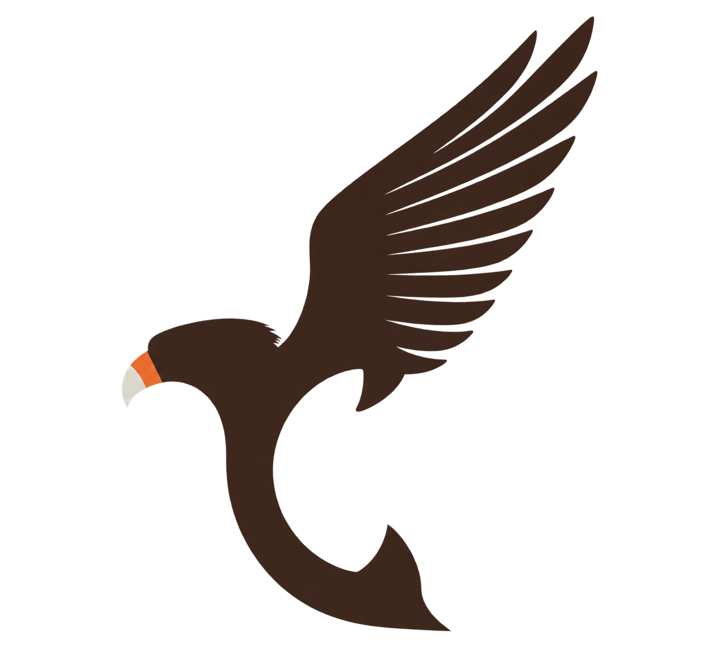

<p align="center">
  
</p>

<h1 align="center">myLinux</h1>

<p align="center">
  Personal 🐧 Linux workstation toolkit — installers, maintenance scripts, and dotfiles.
</p>

<p align="center">
  
  
  <a href="https://github.com/cogumm/mylinux/commits/main">
    
  </a>
  <a href="#memo-license">
    
  </a>
  <a href="https://github.com/cogumm/mylinux/stargazers">
    
  </a>
</p>

<p align="center">
  <a href="#what-is-this">What is this</a>&nbsp;&nbsp;|&nbsp;&nbsp;
  <a href="#requirements">Requirements</a>&nbsp;&nbsp;|&nbsp;&nbsp;
  <a href="#quick-start">Quick start</a>&nbsp;&nbsp;|&nbsp;&nbsp;
  <a href="#repository-layout">Layout</a>&nbsp;&nbsp;|&nbsp;&nbsp;
  <a href="#docs">Docs</a>&nbsp;&nbsp;|&nbsp;&nbsp;
  <a href="#how-to-contribute">Contribute</a>&nbsp;&nbsp;|&nbsp;&nbsp;
  <a href="#memo-license">License</a>
</p>

---

## What is this

**myLinux** is a personal toolkit for Debian/Ubuntu-family machines (and WSL2 helpers):

| Piece | Role |
|-------|------|
| **[Carcará 1.x](carcara/README.md)** | Install engine + CLI/TUI (Bash + Zenity/Yad) |
| **[Carcará 2.0](carcara-electron/README.md)** | Electron desktop UI (alpha; reuses 1.x backends) |
| **`dotfiles/`** | Shell aliases, Bash/Zsh themes, git template, Hyper |
| **`old/`** | Frozen legacy scripts — archive only |
| **`cleanup-zone-identifiers.sh`** | Remove Windows `*:Zone.Identifier` junk on WSL |

Target: **apt-based** distros (Ubuntu, Debian, Linux Mint), primarily `x86_64`.

> **Disclaimer:** many scripts need **root** and can change your system. Review them before running. Use only if you understand what they do. The author is not responsible for damage from misuse.

## Requirements

- Git
- `sudo` / root for Carcará system menus
- UI deps (Carcará tries to install these): `yad`, `zenity`, `curl`, optional `snap`

```bash
sudo apt install git
```

Optional: configure your Git identity before cloning.

```bash
git config --global user.name 'Your name'
git config --global user.email 'you@example.com'
```

## Quick start

### One-liner (bootstrap)

Clones into `~/myLinux` (or `$MYLINUX_DIR`) if needed, then opens the chooser:

```bash
sudo curl -L https://raw.githubusercontent.com/cogumm/myLinux/main/start.sh | bash
```

Requires `git`. The published `main` script clones/updates `~/myLinux` (override with `MYLINUX_DIR`) and reopens the menu (drops back to your user if started with `sudo`). Review remote scripts before piping to bash; prefer a local clone when you can.

### Carcará (choose UI)

From a local clone, pick **Electron 2.0** or **terminal 1.x**:

```bash
git clone https://github.com/cogumm/myLinux.git
cd myLinux
./start.sh
```

| Flag | Mode |
|------|------|
| `./start.sh` | Interactive menu (Zenity if available, else terminal prompt) |
| `./start.sh --electron` | Carcará 2.0 (needs [Bun](https://bun.sh)) |
| `./start.sh --terminal` | Carcará 1.x via `sudo bash carcara/startApp.sh` |

Direct entries still work: `cd carcara && sudo bash startApp.sh` · `cd carcara-electron && bun run dev`.  
Plan: [`.agents/idea/carcara-2.0-electron.md`](.agents/idea/carcara-2.0-electron.md).

**`.deb` / AppImage (2.0):** publish a GitHub Release (tag `vX.Y.Z`) — [`.github/workflows/release-deb.yml`](.github/workflows/release-deb.yml) builds and attaches `carcara_*_amd64.deb` + AppImage. Local: `cd carcara-electron && bun run pack:linux`.

### Dotfiles

```bash
cd dotfiles
./apply.sh --dry-run --all   # preview (*.bak backups)
./apply.sh --aliases         # default module
```

Details: [docs/dotfiles.md](docs/dotfiles.md). Do **not** run as root.

### WSL cleanup

```bash
./cleanup-zone-identifiers.sh              # current directory
./cleanup-zone-identifiers.sh /path/to/dir
./cleanup-zone-identifiers.sh /path -f     # non-interactive
```

See [docs/wsl-cleanup.md](docs/wsl-cleanup.md).

## Brand

Primary mark: [`assets/img/logo_moderno_final.png`](assets/img/logo_moderno_final.png) (used in this README, Carcará 1.x docs, and Electron 2.0).

<p align="center">
  
  &nbsp;
  
  &nbsp;
  
  &nbsp;
  
</p>

## Repository layout

```
.
├── start.sh                      # Choose Electron 2.0 or terminal 1.x
├── assets/                       # Images for 1.x + 2.0 (img/logo_*.png)
├── carcara/                      # 1.x engine + TUI (entry: startApp.sh)
├── carcara-electron/             # 2.0 Electron + Bun (entry: bun run dev)
├── dotfiles/                     # Aliases, bashrc, oh-my-zsh, git, Hyper
├── old/                          # Legacy archive (do not extend)
├── cleanup-zone-identifiers.sh   # WSL helper
├── docs/                         # Operator docs
├── design-system/carcara/        # 1.x TUI UX notes
├── design-system/carcara-2-0/    # 2.0 Flat Design tokens (ui-ux-pro-max)
├── AGENTS.md                     # Agent entry
├── .agents/                      # Agent-agnostic idea + playbook + skills
├── .cursor/rules/                # Cursor adapter
└── .claude/rules/                # Claude Code adapter (same policies)
```

## Docs

- [Overview](docs/overview.md)
- [Carcará](docs/carcara.md)
- [Dotfiles](docs/dotfiles.md)
- [Legacy `old/`](docs/legacy.md)
- [WSL cleanup](docs/wsl-cleanup.md)
- [AGENTS.md](AGENTS.md) — for coding agents

## How to contribute

- Fork this project
- Create a branch: `git checkout -b my-feature`
- Commit: `git commit -m 'feat: My new feature'`
- Push: `git push origin my-feature`
- Open a pull request

Prefer improving `carcara/`, `carcara-electron/`, or `dotfiles/`. Leave `old/` as archive.

## :memo: License

This project is under the MIT license (Copyright (c) 2010 CoGUMm). See [LICENSE][license].

Made with ♥ by Gabriel F. Vilar :wave: [Ko-fi][kofi]

[license]: https://cogumm.mit-license.org/
[telegram]: https://t.me/CoGUMm
[kofi]: https://ko-fi.com/cogumm
